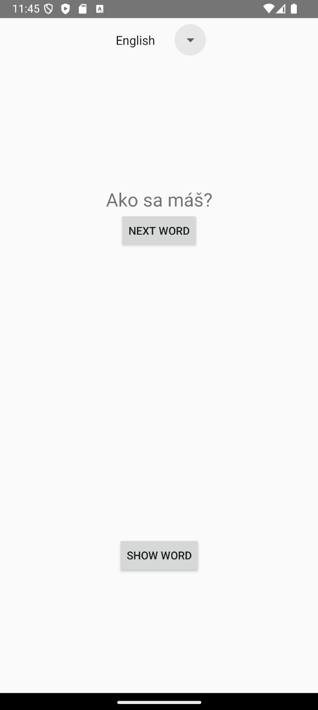
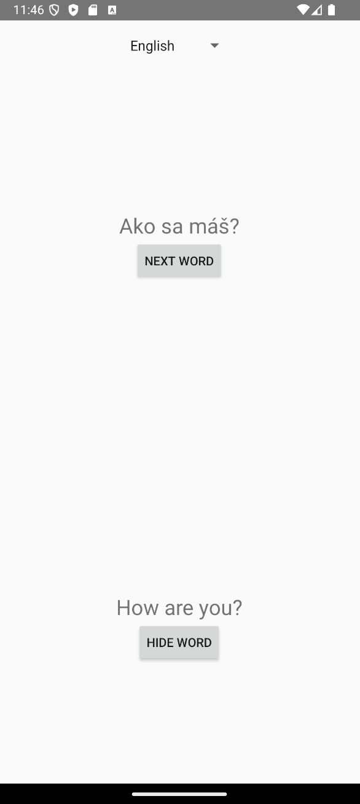

# LanguageLearner

A simple Android application developed in **Kotlin** for practicing vocabulary in different languages.

The app displays Slovak words and allows users to reveal their translations in a selected foreign language.

## Features

- Vocabulary practice in **English, German, Spanish, and Klingon**
- Show or hide translations
- Navigate through words using the **Next Word** button
- Switch languages while keeping the current word

## Screenshots

| Hidden translation | Revealed translation |
|:---:|:---:|
|  |  |

## Technologies

- **Kotlin** – application development
- **MVVM** – application architecture
- **Fragments & LiveData** – UI components and data synchronization
- **XML** – user interface layouts
- **TXT files** – local vocabulary storage

## Installation

Download the APK from the [latest release](https://github.com/Kuboo01/LanguageLearner/releases/latest) and install it on an Android device.

## About

Developed as a university assignment focused on Android application development and the MVVM architecture.
